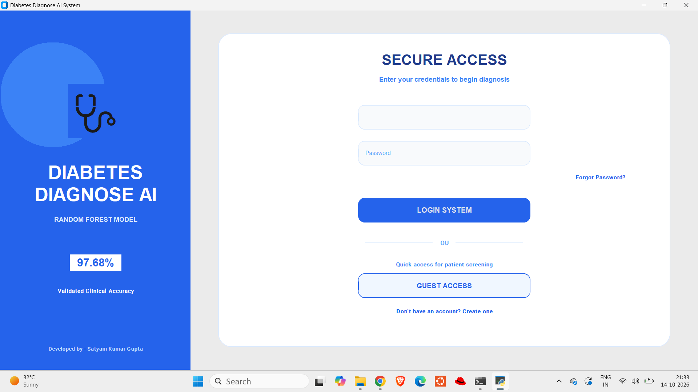
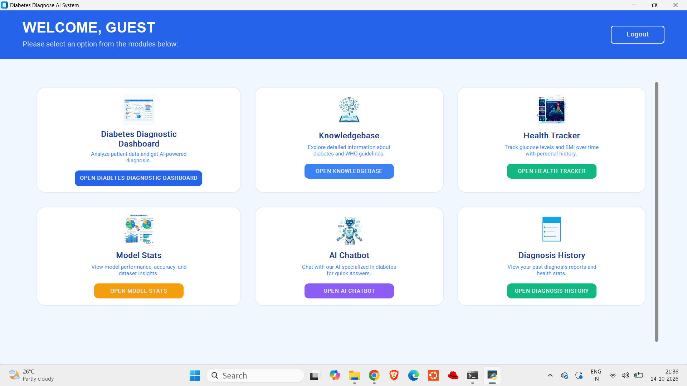
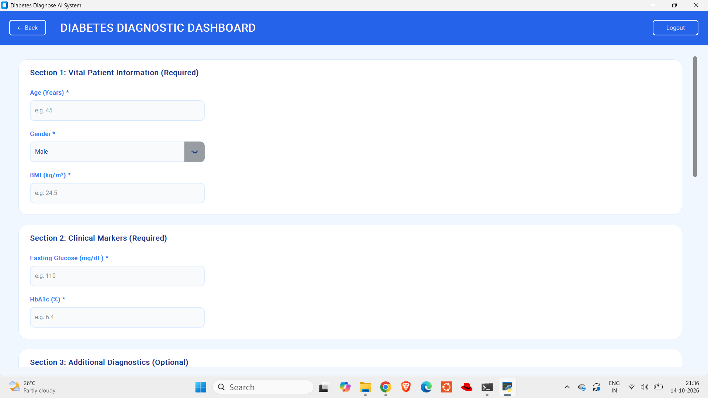
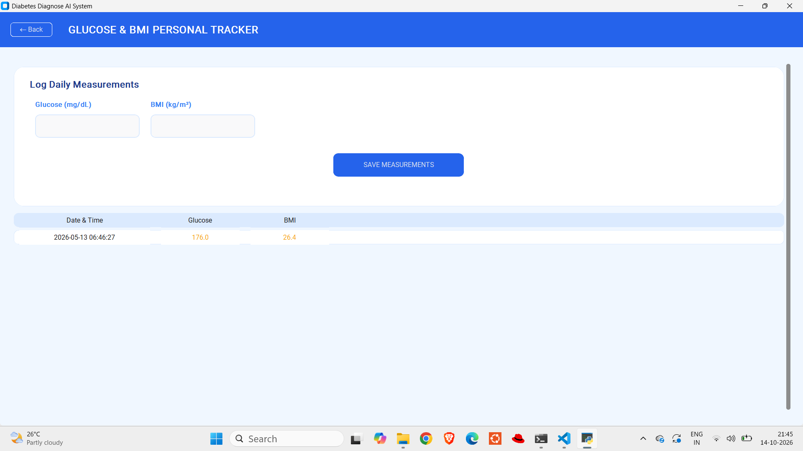
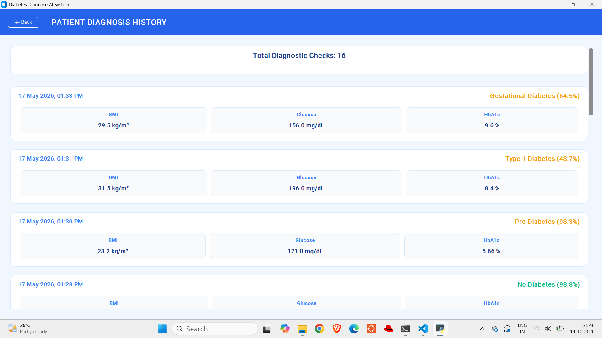
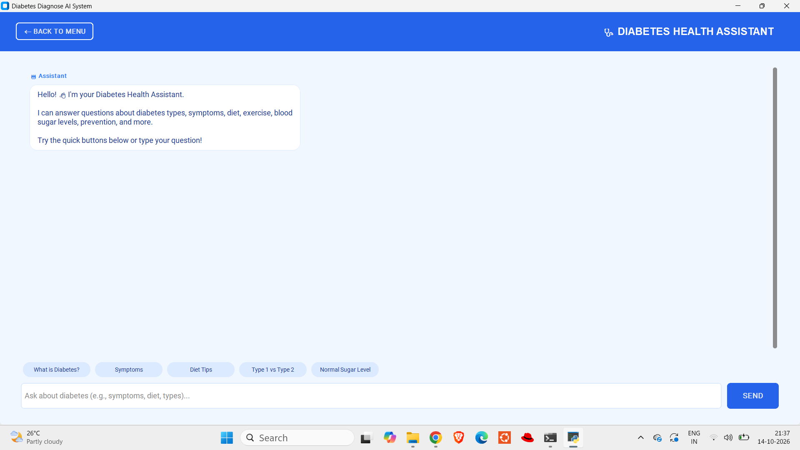
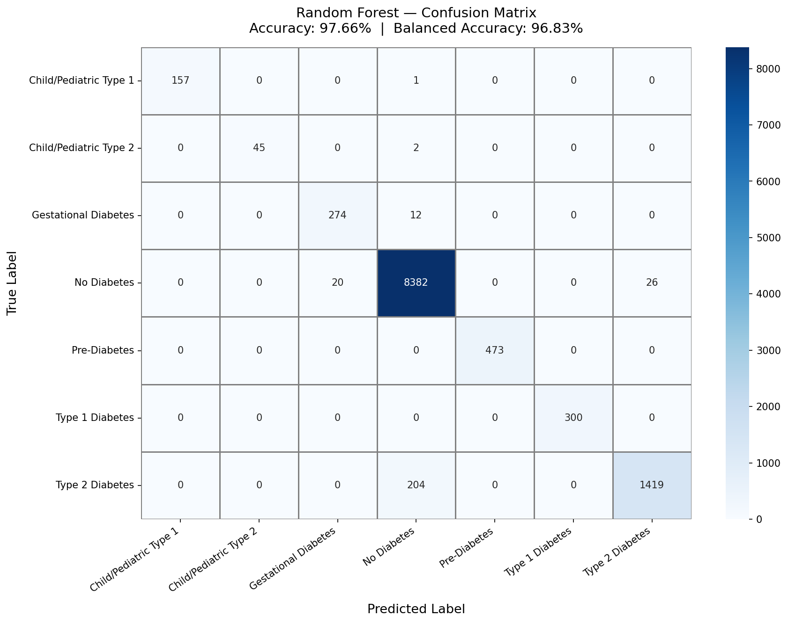
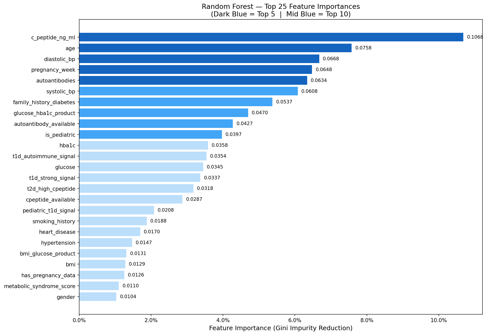
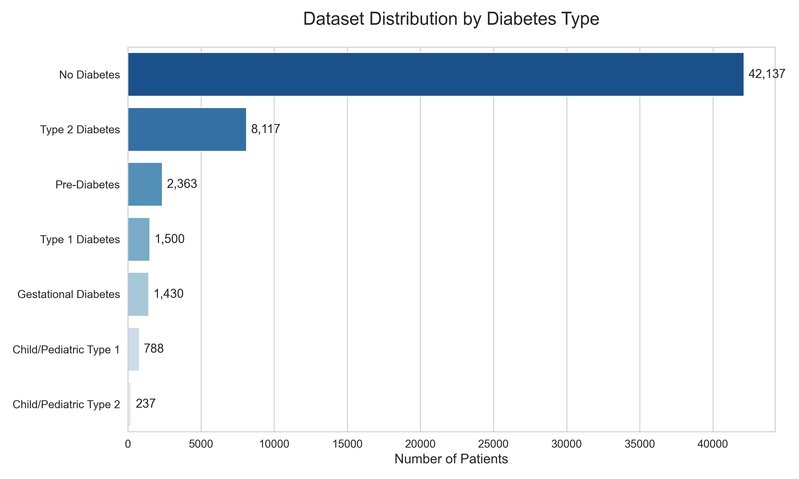

<div align="center">

#  Diabetes Analysis based on  AI/ML AlgorithmsS

** MCA final year project - daibetes analysis system using AI/ML Algorithms ,A desktop application that predicts the type of diabetes from patient data using a Random Forest model, then recommends treatment, diet and precautions.**


</div>

---

##  Overview

**Diabetes Diagnose AI System** is a Python desktop app with a modern blue-and-white GUI. A user signs in, enters clinical values (age, BMI, glucose, HbA1c, etc.) and the trained machine-learning model classifies the case into one of **7 categories**. The app then shows a rule-based medicine / diet / precaution recommendation and lets the user download a report.

>  **Disclaimer:** This project is for educational and research purposes only. It is **not** a medical device and must not replace advice from a qualified doctor.

## Screenshots

<!-- Replace the image files in /screenshots with your own. Keep the same file names, or edit the paths below. -->

| Login | Main Menu |
|:---:|:---:|
|  |  |

| Diagnostic Dashboard | Prediction Result |
|:---:|:---:|
|  |  ||

| Health Tracker | Diagnosis History |
|:---:|:---:|
|  |  |

| AI Chatbot | Knowledge Base |
|:---:|:---:|
|  |  |

## Features

| Module | Description |
|---|---|
| **Authentication** | Sign up / log in with salted SHA-256 password hashing (SQLite). Guest mode available with limited features. |
|  **Diagnostic Dashboard** | Enter patient data with live input validation and get an AI diagnosis with confidence score. |
|  **Treatment Recommender** | Suggests medicine, dosage, precautions, diet and foods to avoid, based on diabetes type, HbA1c severity, age, BMI and gender (ADA-style rules). |
|  **Report Export** | Download a detailed diagnosis report as a `.txt` file. |
|  **Health Tracker** | Log glucose and BMI over time per user. |
|  **Diagnosis History** | Review all your past diagnoses and health stats. |
|  **Model Stats** | View accuracy, confusion matrix, feature importance and dataset distribution inside the app. |
|  **Diabetes Chatbot** | Offline Q&A assistant backed by a built-in diabetes knowledge base, with quick-question buttons. |
|  **Knowledge Base** | Browsable articles on diabetes types, symptoms, WHO guidelines and more. |

##  Classes Predicted

1. No Diabetes
2. Pre-Diabetes
3. Type 1 Diabetes
4. Type 2 Diabetes
5. Gestational Diabetes
6. Child / Pediatric Type 1
7. Child / Pediatric Type 2

##  Model Performance

Random Forest trained on **56,572 records** (merged from several public diabetes datasets) with medically grounded feature engineering (e.g. autoantibodies + low C-peptide → Type 1 signal; pregnancy + elevated glucose → gestational signal) and class-balanced weights.

| Metric | Score |
|---|---|
| Overall Accuracy | **97.66 %** |
| Balanced Accuracy | **96.83 %** |
| OOB Score | 97.62 % |
| 5-Fold CV (mean) | 97.65 % ± 0.08 |

<details>
<summary><b>Per-class report</b></summary>

| Class | Precision | Recall | F1 | Support |
|---|---:|---:|---:|---:|
| Child/Pediatric Type 1 | 1.000 | 0.994 | 0.997 | 158 |
| Child/Pediatric Type 2 | 1.000 | 0.957 | 0.978 | 47 |
| Gestational Diabetes | 0.932 | 0.958 | 0.945 | 286 |
| No Diabetes | 0.975 | 0.995 | 0.984 | 8428 |
| Pre-Diabetes | 1.000 | 1.000 | 1.000 | 473 |
| Type 1 Diabetes | 1.000 | 1.000 | 1.000 | 300 |
| Type 2 Diabetes | 0.982 | 0.874 | 0.925 | 1623 |

</details>

<p align="center">
  
  
</p>
<p align="center">
  
</p>

##  Datasets & How They Were Combined

The final training file (`finaldeta.csv`, **56,572 rows**) was built in three stages.

### Stage 1 — Public datasets → `unifieddataset.csv` (`combine_dataset.py`)

| # | Dataset | Original size | Rows used | Source |
|---|---|---:|---:|---|
| 1 | Diabetes Prediction Dataset (`diabetes_prediction_dataset.csv`) | 100,000 | 40,000 (random sample, `random_state=42`) | [Kaggle – iammustafatz](https://www.kaggle.com/datasets/iammustafatz/diabetes-prediction-dataset) |
| 2 | Pima Indians Diabetes (`pima_diabetes.csv`) | 768 | all | [Kaggle – uciml](https://www.kaggle.com/datasets/uciml/pima-indians-diabetes-database) (original: NIDDK) |
| 3 | CDC BRFSS 2015 Health Indicators (`diabetes_012_health_indicators_BRFSS2015.csv`) | 253,680 | 34,232 (stratified by class) | [Kaggle – alexteboul](https://www.kaggle.com/datasets/alexteboul/diabetes-health-indicators-dataset) |
| 4 | Dataset of Diabetes, Iraqi clinical data (`Dataset_of_Diabetes.csv`) | ~1,000 | 264 | [Mendeley Data (DOI 10.17632/wj9rwkp9c2.1)](https://data.mendeley.com/datasets/wj9rwkp9c2/1) |

**Steps performed by `combine_dataset.py`:**

1. **Standardise columns.** Every dataset is mapped to one shared schema: `gender, age, bmi, glucose, hba1c, insulin, pregnancies, blood_pressure, cholesterol, hypertension, heart_disease, smoking_history, diabetes_label, source`. Columns a dataset does not have are left empty (NaN).
2. **Decode values.** BRFSS coded age bands (1–13) are converted to approximate ages, and `Sex`, `HighBP`, `HighChol`, `Smoker` codes become readable values. Pima rows are all set to `Female`.
3. **Sample.** Dataset 1 is randomly sampled and dataset 3 is sampled per class so class proportions are kept. Datasets 2 and 4 are used in full.
4. **Concatenate, drop duplicates and shuffle** (`random_state=42`), then add a `source` tag to every row.
5. **Assign a diabetes type** with a rule-based function (`classify_diabetes_type`):
   - label 0 → *No Diabetes*; BRFSS class 1 → *Pre-Diabetes*
   - diabetic + female + pregnancies ≥ 1 → *Gestational*
   - diabetic + age < 18 → *Child Diabetes*
   - diabetic + age < 30 + low/no insulin → *Type 1*
   - all other diabetic cases → *Type 2*
6. **Add helper columns** (`has_pregnancy_data`, `age_group`) and save as `unifieddataset.csv` (49,202 rows).

---

### Stage 2 — Type-specific clinical datasets → `combined_diabetes_final.csv`

Five files in `dataset2.0/` provide detailed records for the rarer diabetes types. Each was reduced to a common set of 12 columns (`diagnosis, gender, age, bmi, fasting_glucose_mg_dl, hba1c_pct, systolic_bp, diastolic_bp, family_history_diabetes, c_peptide_ng_ml, autoantibodies, pregnancy_week`) and stacked into one file of 7,500 rows.

| File | Rows |
|---|---:|
| `type1_diabetes_dataset.csv` | 1,500 |
| `type2_diabetes_dataset.csv` | 2,000 |
| `gestational_diabetes_dataset.csv` | 1,200 |
| `prediabetes_dataset.csv` | 1,800 |
| `child_pediatric_diabetes_dataset.csv` | 1,000 |

> **Data Sources & Preparation:** The five files above were **not collected from a single source**. They were built by downloading data from the public repositories listed below, applying clinical filtering rules in Python, and synthesising missing columns (e.g. `c_peptide_ng_ml`, `autoantibodies`, `pregnancy_week`) using medically grounded distributions with the help of an AI assistant. The resulting CSVs therefore combine real statistical patterns from the source datasets with synthetically generated feature values.

#### Source links by diabetes type

| Type | Dataset | Link |
|---|---|---|
| **Type 1** | T1D Exchange Registry | https://t1dexchange.org/registry/ |
| **Type 1** | Glucose-ML Collection (CGM) | https://arxiv.org/abs/2507.14077 |
| **Type 1** | UVA/Padova T1D Simulator | https://www.ncbi.nlm.nih.gov/pmc/articles/PMC2769652/ |
| **Type 1** | UCI Diabetes (Type 1 records) | https://archive.ics.uci.edu/dataset/34/diabetes |
| **Type 2** | PIMA Indian Diabetes (UCI) | https://archive.ics.uci.edu/dataset/17/pima+indians+diabetes |
| **Type 2** | ShanghaiT2DM Dataset | https://www.ncbi.nlm.nih.gov/pmc/articles/PMC9849330/ |
| **Type 2** | Kaggle Diabetes Dataset 2019 | https://www.kaggle.com/datasets/tigganeha4/diabetes-dataset-2019 |
| **Type 2** | Mendeley T2D Dataset | https://data.mendeley.com/datasets/wj9rwkp9c2/1 |
| **Type 2** | Bangladesh T2D Clinical Dataset | https://www.ncbi.nlm.nih.gov/pmc/articles/PMC12855581/ |
| **Prediabetes** | CDC BRFSS Health Indicators | https://www.kaggle.com/datasets/alexteboul/diabetes-health-indicators-dataset |
| **Prediabetes** | CDC BRFSS Raw (2015) | https://www.kaggle.com/datasets/cdc/behavioral-risk-factor-surveillance-system |
| **Prediabetes** | Diabetes Prediction Dataset (100K) | https://www.kaggle.com/datasets/iammustafatz/diabetes-prediction-dataset |
| **Gestational** | GDM Kaggle Dataset | https://www.kaggle.com/datasets/sumathisanthosh/gestational-diabetes-mellitus-gdm-data-set |
| **Gestational** | Pone Gestational Dataset (via DTD paper) | https://pubmed.ncbi.nlm.nih.gov/41540069/ |
| **Child/Pediatric** | UVA/Padova Simulator (children + adolescents) | https://www.ncbi.nlm.nih.gov/pmc/articles/PMC2769652/ |
| **Child/Pediatric** | Mansoura Pediatric Hospital Data (via DTD) | https://pubmed.ncbi.nlm.nih.gov/41540069/ |
| **Child/Pediatric** | T1D Exchange (pediatric subset) | https://t1dexchange.org/registry/ |

---

### Stage 3 — Merge into the final training set

`unifieddataset.csv` (49,202) + `combined_diabetes_final.csv` (7,500) were merged and the columns renamed to one schema (`glucose`, `hba1c`, `diabetes_type_name`, …). The 130 Type 1 rows that stage 1 guessed from age and insulin were dropped, because stage 2 has properly labelled Type 1 cases (autoantibodies and C-peptide). The child class was then split into **Child/Pediatric Type 1** and **Type 2** using the `diabetes_subtype` field of the pediatric file. This gives 56,572 rows:

| Class | Rows |
|---|---:|
| No Diabetes | 42,137 |
| Type 2 Diabetes | 8,117 |
| Pre-Diabetes | 2,363 |
| Type 1 Diabetes | 1,500 |
| Gestational Diabetes | 1,430 |
| Child/Pediatric Type 1 | 788 |
| Child/Pediatric Type 2 | 237 |

Because the sources measure different things, many columns are mostly empty in the final file (for example `c_peptide_ng_ml` is about 92% empty). The training script (`diabetes_rf_model.py`) fills these gaps and adds engineered clinical features such as autoantibody and C-peptide signals.

##  Project Structure

```
diabetes-Analysis-ai/
├── frontend/                  # CustomTkinter GUI
│   ├── main_gui.py            # ▶ App entry point
│   ├── auth_frames.py         # Login / Signup screens
│   ├── selection_frame.py     # Main menu (module cards)
│   ├── dashboard_frames.py    # Dashboard, Analytics, Tracker, History
│   ├── info_frames.py         # Result screen + Knowledge Base
│   ├── chatbot_frame.py       # Chatbot UI
│   ├── diabetes_kb.py         # Chatbot knowledge base
│   └── config.py              # Colors & settings
├── db/
│   └── auth_db.py             # SQLite: users, vitals, diagnosis history
├── assets/                    # Menu icons
├── dataset2.0/                # Per-type clinical datasets (stage 2)
├── datasets/                  # Raw public datasets
├── trained_model1/            # Metrics, plots, classification report
├── screenshots/               # App screenshots used in this README
├── combine_dataset.py         # Merges datasets into one training file
├── diabetes_rf_model.py       # Feature engineering + model training
├── patient_predict.py         # Console-based prediction tool
├── medicine_recommender.py    # Rule-based treatment recommender
├── medicine.csv               # Medicine / diet / precaution table
├── finaldeta.csv              # Final training dataset
└── requirements.txt
```

##  Getting Started

### 1. Clone the repository
```bash
git clone https://github.com/gupta032satyam/diabetes-Analysis-ai.git
cd diabetes-Analysis-ai
```

### 2. Create a virtual environment (recommended)
```bash
python -m venv venv
# Windows
venv\Scripts\activate
# macOS / Linux
source venv/bin/activate
```

### 3. Install dependencies
```bash
pip install -r requirements.txt
```

### 4. Get the trained model
The trained model file `diabetes_rf_model.pkl` is large (~150 MB), so it is not stored in the Git history .

- **Train it yourself** (takes a few minutes):
  ```bash
  # make sure the training CSV is named finaldeta.csv
  python diabetes_rf_model.py
  # then copy outputs/diabetes_rf_model.pkl to the project root
  ```

### 5. Run the app
```bash
cd frontend
python main_gui.py
```
Create an account on the sign-up screen, or continue as guest.

### Optional: console prediction
```bash
python patient_predict.py
```

##  Tech Stack

- **Language:** Python
- **ML:** scikit-learn (Random Forest), pandas, NumPy, joblib
- **Visualization:** Matplotlib, Seaborn
- **GUI:** CustomTkinter, Pillow
- **Database:** SQLite

##  Future Improvements

- Replace the rule-based chatbot with an LLM-powered assistant
- Export reports as PDF
- Package as a standalone `.exe` with PyInstaller
- Add charts for tracker trends over time
- Web version (Flask / Streamlit)

##  Contributing

Pull requests are welcome. For major changes, please open an issue first to discuss what you would like to change.

##  Acknowledgements

- [Diabetes Prediction Dataset – iammustafatz (Kaggle)](https://www.kaggle.com/datasets/iammustafatz/diabetes-prediction-dataset)
- [Pima Indians Diabetes Database – UCI ML (Kaggle)](https://www.kaggle.com/datasets/uciml/pima-indians-diabetes-database)
- [Diabetes Health Indicators (CDC BRFSS 2015) – Alex Teboul (Kaggle)](https://www.kaggle.com/datasets/alexteboul/diabetes-health-indicators-dataset)
- [Dataset of Diabetes – Rashid, A. (Mendeley Data, 2020)](https://data.mendeley.com/datasets/wj9rwkp9c2/1)
- [CustomTkinter](https://github.com/TomSchimansky/CustomTkinter), [scikit-learn](https://scikit-learn.org/)

##  License

Distributed under the MIT License. See `LICENSE` for more information.

##  Author

Satyam kumar Gupta — [GitHub](https://github.com/gupta032satyam) · [LinkedIn](https://linkedin.com/in/<your-profile>)

 If you found this project useful, please give it a star!
